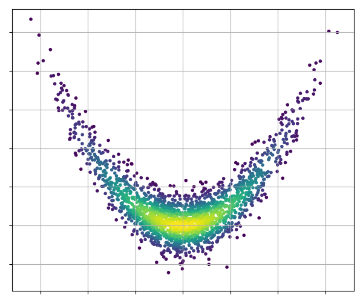
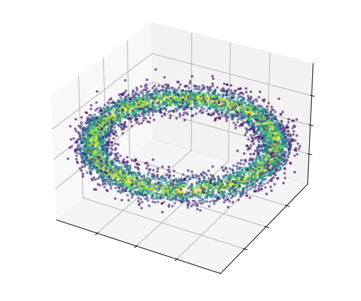
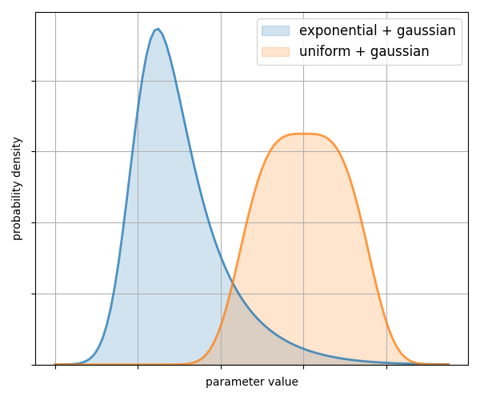
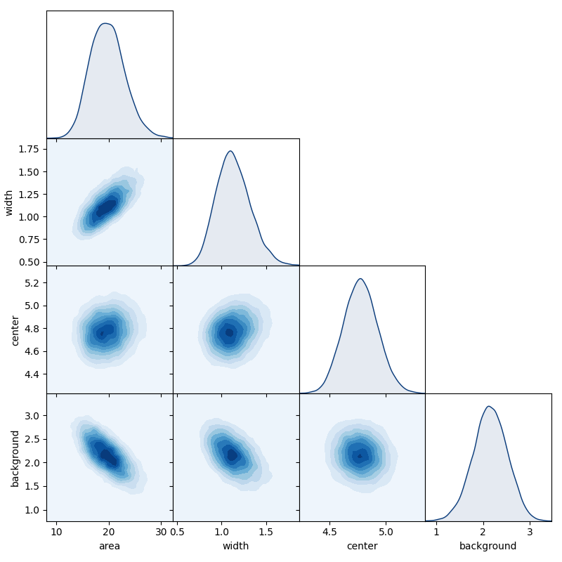
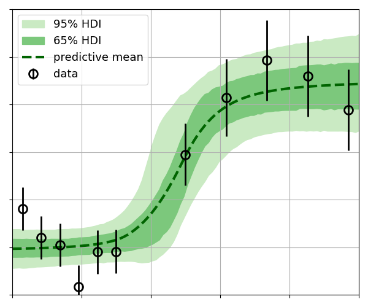
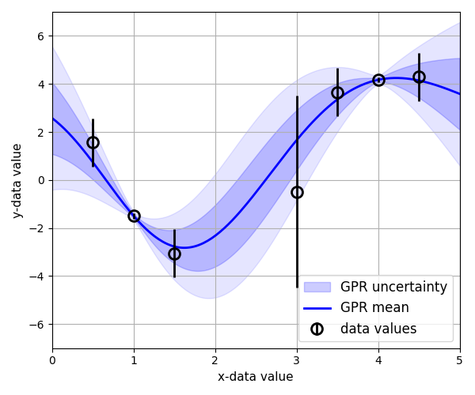

<picture>
  <source media="(prefers-color-scheme: dark)" srcset="https://raw.githubusercontent.com/C-bowman/inference-tools/master/docs/source/_static/logo_dark_bg.svg">
  
</picture>

[](https://inference-tools.readthedocs.io/en/stable/?badge=stable)
[](https://github.com/C-bowman/inference-tools/blob/master/LICENSE)
[](https://pypi.org/project/inference-tools/)

[](https://zenodo.org/badge/latestdoi/149741362)

This package provides a set of Python-based tools for Bayesian data analysis
which are simple to use, allowing them to be applied quickly and easily.

Inference-tools is not a framework for Bayesian modelling (e.g. like [PyMC](https://docs.pymc.io/)),
but instead provides tools to sample from user-defined models using MCMC, and to analyse and visualise
the sampling results.

## Features

 - Implementations of MCMC algorithms like Gibbs sampling and Hamiltonian Monte-Carlo for 
 sampling from user-defined posterior distributions.
 
 - Density estimation and plotting tools for analysing and visualising inference results.
 
 - Gaussian-process regression and optimisation.


<table>
  <tr>
    <td align="center" width="33%">
      <a href="https://github.com/C-bowman/inference-tools/blob/master/demos/gibbs_sampling_demo.ipynb">
        
        <br>Gibbs Sampling
      </a>
    </td>
    <td align="center" width="33%">
      <a href="https://github.com/C-bowman/inference-tools/blob/master/demos/hamiltonian_mcmc_demo.ipynb">
        
        <br>Hamiltonian Monte-Carlo
      </a>
    </td>
    <td align="center" width="33%">
      <a href="https://github.com/C-bowman/inference-tools/blob/master/demos/density_estimation_demo.ipynb">
        
        <br>Density estimation
      </a>
    </td>
  </tr>
  <tr>
    <td align="center" width="33%">
      
      <br>Matrix plotting
    </td>
    <td align="center" width="33%">
      
      <br>Highest-density intervals
    </td>
    <td align="center" width="33%">
      <a href="https://github.com/C-bowman/inference-tools/blob/master/demos/gp_regression_demo.ipynb">
        
        <br>GP regression
      </a>
    </td>
  </tr>
</table>

## Installation

inference-tools is available from [PyPI](https://pypi.org/project/inference-tools/), 
so can be easily installed using [pip](https://pip.pypa.io/en/stable/) as follows:
```bash
pip install inference-tools
```

## Documentation

Full documentation is available at [inference-tools.readthedocs.io](https://inference-tools.readthedocs.io/en/stable/).

## Citing

If you use inference-tools in your work, please cite it using the Zenodo DOI
[10.5281/zenodo.1423551](https://doi.org/10.5281/zenodo.1423551). Citation metadata is
also available via the "Cite this repository" button on GitHub.