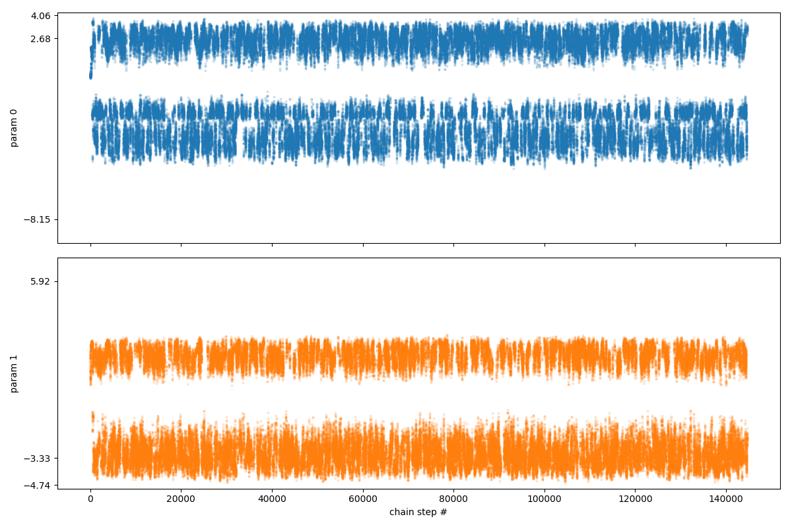
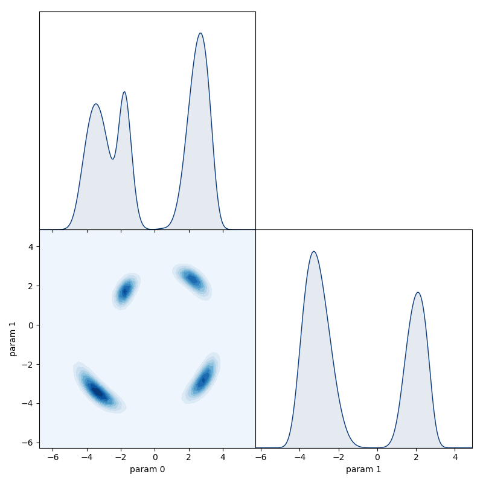

ParallelTempering
~~~~~~~~~~~~~~~~~

.. autoclass:: inference.mcmc.ParallelTempering
   :members: advance, run_for, shutdown, return_chains

ParallelTempering example code
^^^^^^^^^^^^^^^^^^^^^^^^^^^^^^

A more detailed example can also be found in the
`parallel tempering jupyter notebook demo <https://github.com/C-bowman/inference-tools/blob/master/demos/parallel_tempering_demo.ipynb>`_.

Define a posterior with separated maxima, which is difficult
for a single chain to explore:

.. code-block:: python

   from numpy import log, sqrt, sin, arctan2, pi

   # define a posterior with multiple separate peaks
   def multimodal_posterior(theta):
      x, y = theta
      r = sqrt(x**2 + y**2)
      phi = arctan2(y, x)
      z = (r - (0.5 + pi - phi*0.5)) / 0.1
      return -0.5*z**2  + 4*log(sin(phi*2.)**2)

When an instance of ``ParallelTempering`` is created, a dedicated process for each
chain is spawned. These separate processes will automatically make use of the available
cpu cores, such that the computations to advance the separate chains are performed in parallel.

Save the example as a Python script, keeping ``multimodal_posterior`` defined at
module level so it can be imported by worker processes. Protect the code which
starts the workers with an ``if __name__ == "__main__":`` guard, as required by
``multiprocessing`` on platforms such as Windows.

Here we create one chain for each temperature level, run the sampler, and recover
copies of the chains using ``return_chains``. The context manager automatically
shuts down the workers when the ``with`` block ends, including if sampling or
retrieving the chains raises an exception:

.. code-block:: python

   from inference.mcmc import GibbsChain, ParallelTempering

   if __name__ == "__main__":
       N_levels = 6
       temperatures = [10**(2.5*k/(N_levels-1.)) for k in range(N_levels)]
       chains = [
           GibbsChain(posterior=multimodal_posterior, start=[0.5, 0.5], temperature=T)
           for T in temperatures
       ]

       with ParallelTempering(chains=chains) as PT:
           PT.run_for(minutes=0.5)
           chains = PT.return_chains()

       chains[0].trace_plot()
       chains[0].matrix_plot()

Retrieve the chains inside the ``with`` block: they are not retrieved automatically,
and ``return_chains`` cannot be called after shutdown. The recovered chains and
``PT.swap_diagnostics()`` can be plotted after the worker processes have shut down.
To sample again, create a new ``ParallelTempering`` instance.

The context manager does not remove the need for the script's main guard or an
importable posterior function. In a notebook, import the posterior from a Python
module rather than defining it in a cell when using a spawn-based platform such
as Windows, and keep the complete ``with`` block in one cell. The notebook demo
shows this approach.

Manual use with an explicit ``shutdown`` call remains supported. See its API
documentation above for the grace period and forced-termination behavior.

By looking at the trace plot for the T = 1 chain, we see that it makes
large jumps across the parameter space due to the swaps:

Even though the posterior has strongly separated peaks, the T = 1 chain
was able to explore all of them due to the swaps.

